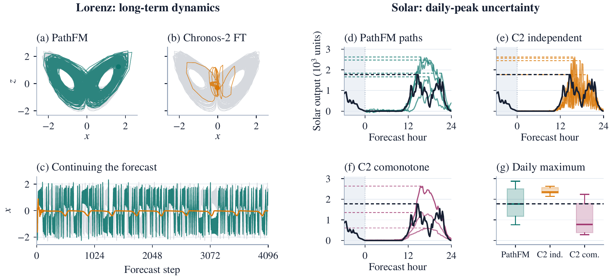
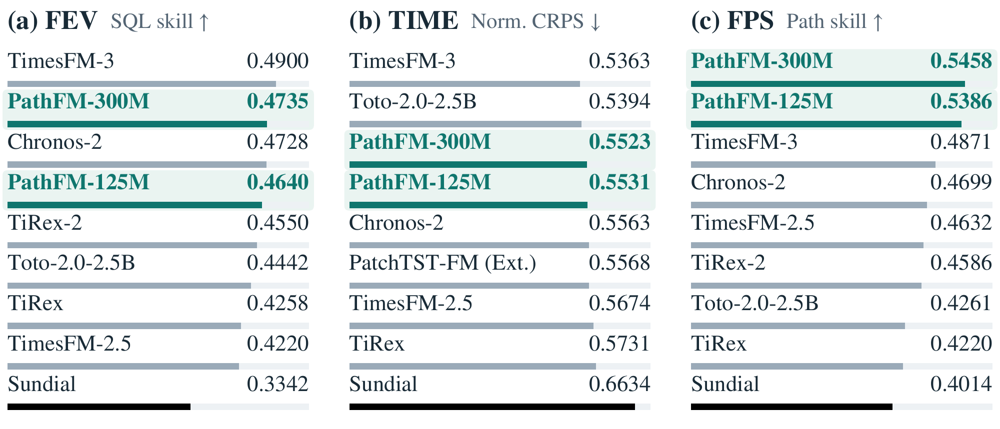
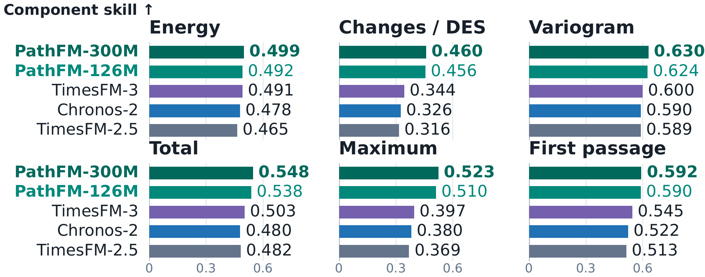
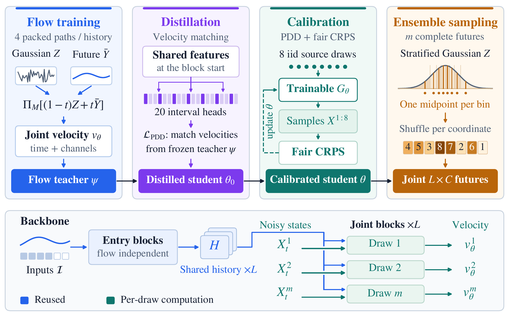
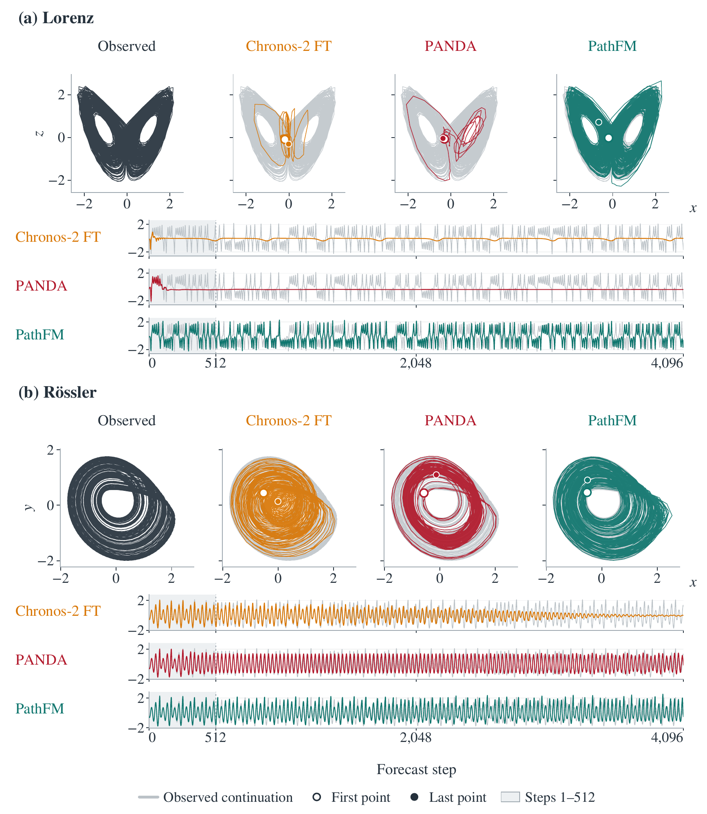

# PathFM: Fast Generative Forecasting of Multivariate Trajectories

[](https://arxiv.org/abs/2610.22358)
[](#models)
[](https://pathfm.scientific.ml)
[](https://fpsbench.scientific.ml)

**One forecast ensemble for many downstream questions.**
PathFM generates coherent multivariate futures that you can sample, summarize, and continue.
Use the sampled paths to forecast cumulative demand, peak load, and autocorrelation, or explore the long-run behavior of a chaotic system.

**Jiachen Yao, Xiyuan Zhang, Annan Yu, Boran Han, Abdul Fatir Ansari, Shuai Zhang, Michael Bohlke-Schneider, and Bernie Wang**  
California Institute of Technology · Amazon

## Highlights

- **Leading trajectory quality:** the 125M and 300M general models achieve the two highest aggregate path scores on fps-bench.
- **Fast ensemble generation:** the 125M model generates 32 forecast paths in about 50 ms on an NVIDIA L4, using a single distilled sampling step.
- **Strong marginal accuracy:** PathFM-300M ranks 2nd on fev-bench and 3rd on TIME as of September 26, 2026.
- **Sustained chaotic dynamics:** specialized models combine accurate short-horizon predictions with long rollouts that retain variability and dynamical structure.



*The Lorenz example shows a sampled PathFM rollout retaining the two-lobe structure and sustained variability.*
*The solar example shows how temporal dependence changes the predicted daily maximum, even when marginal quantiles stay the same.*
*Complete paths make these downstream distributions directly accessible.*

## Results

PathFM combines leading path quality with competitive marginal forecasting.
Both general models outperform every evaluated external baseline on aggregate FPS skill.



### Forecast Path Score Bench (fps-bench)

**fps-bench evaluates what happens along a forecast path.**
It extends fev-bench with six complementary scores: energy score, differenced energy score, variogram score, and CRPS for horizon totals, maxima, and first-passage times.
These scores assess temporal structure and uncertainty in quantities that matter for downstream decisions.

<details>
<summary>See the six path-score components</summary>



</details>

## How it works

PathFM learns a conditional flow over complete future trajectories, coupling time steps and variables.
We put efforts into making it fast, sample-efficient, and easy to use.
[Check out our paper!](https://arxiv.org/abs/2610.22358)



<!-- The general checkpoints use one-step parallel decoding by default.
The chaotic checkpoints use ten-step Euler sampling. -->

## Installation

Clone the repository and install with Python 3.11+:

```bash
git clone https://github.com/autogluon/PathFM.git
cd PathFM
pip install .
```

## Models

| Model | Training context length | Native forecast | Hugging Face |
|---|---:|---:|---|
| PathFM-125M | Up to 8,192 steps | 480 steps | [Weights](https://huggingface.co/autogluon/pathfm-125m) |
| PathFM-300M | Up to 8,192 steps | 480 steps | [Weights](https://huggingface.co/autogluon/pathfm-300m) |
| PathFM-Chaotic-75M | 512 steps | 256 steps | [Weights](https://huggingface.co/autogluon/pathfm-chaotic-75m) |
| PathFM-Chaotic-125M | 512 steps | 256 steps | [Weights](https://huggingface.co/autogluon/pathfm-chaotic-125m) |

Pass a Hub model ID or a local weights folder to `from_pretrained` or `--model`.

## Usage

- `predict_samples`: sample paths up to 480 steps for general models or 256 for chaotic models.
- `rollout`: continue each sampled path independently for a longer horizon.
- `predict_quantiles`: return quantiles and point forecasts.

```python
import torch
from pathfm import PathFMPipeline

torch.manual_seed(42)
model = PathFMPipeline.from_pretrained("autogluon/pathfm-125m", device="cuda")
context = torch.sin(torch.arange(512, dtype=torch.float32) / 10)[None, None, :]
paths = model.predict_samples(context, prediction_length=128)
quantiles, point = model.predict_quantiles(
    context, prediction_length=128, quantile_levels=[0.1, 0.5, 0.9],
)
forecast = model.rollout(context, prediction_length=960, num_samples=32, seed=42)
print(forecast.samples.shape)  # [batch, 32, channels, 960]
torch.save(forecast.samples, "trajectories.pt")
```

Input shape is `[batch, channels, context]`.
Use finite observations for rollouts and `device="cpu"` for CPU inference.

### Forecast totals and peaks

Each sampled path is a complete possible future.
Apply a function to each path to obtain samples of the downstream quantity:

```python
samples = paths[0]  # [channels, samples, horizon] for the first input item
total_samples = samples.sum(dim=-1)  # [channels, samples]
peak_samples = samples.amax(dim=-1)
peak_interval = torch.quantile(
    peak_samples.float(), torch.tensor([0.1, 0.9], device=peak_samples.device), dim=-1,
)  # [2, channels]: an 80% predictive interval for the peak
```

### Chaotic trajectories

**Explore evolving futures over thousands of steps.**
PathFM-Chaotic continues each sampled trajectory from its own history, preserving distinct possible futures through long rollouts.
In the paper's PANDA evaluation, the 125M ten-step model achieves the lowest short-horizon sMAPE among the compared models at every reported horizon.



*The figure shows the paper's 125M chaotic model with ten-step Euler sampling.*
*Phase portraits and time traces cover all 4,096 forecast steps for Lorenz and Rössler.*
*Gray curves show the observed continuations, and shading marks the first 512 forecast steps.*

Explore [the chaotic-model notebook](notebooks/chaotic_forecasting.ipynb) for sample paths, quantiles, interactive 4,096-step rollout plots, and PANDA evaluation.

```bash
pip install ".[benchmarks,notebooks]"
jupyter lab notebooks/chaotic_forecasting.ipynb
```

Save observations in `context.npy` as `[channels, context]` or `[batch, channels, context]`.
The chaotic models default to 16 paths with 10-step Euler sampling.

```bash
python examples/chaotic_rollout.py \
  --model autogluon/pathfm-chaotic-125m --context context.npy --horizon 4096 \
  --seed 42 --device cuda --output rollout.npz
```

## Reproduce the paper

### FEV / FPS / TIME / GIFT

Use a general model and a separate output directory for each model.

```bash
pip install -r requirements.txt
pip install ".[benchmarks]"
python -m pathfm.benchmarks.download fev --output datasets/fev
python -m pathfm.benchmarks.download time --output datasets/time
python -m pathfm.benchmarks.download gift --output datasets/gift

MODEL=autogluon/pathfm-125m
python -m pathfm.benchmarks.fev \
  --model "$MODEL" --data-root datasets/fev --output outputs/fev \
  --device cuda --save-samples
python -m pathfm.benchmarks.fps --fev-output outputs/fev
python -m pathfm.benchmarks.time \
  --model "$MODEL" --data-root datasets/time --output outputs/time --device cuda
python -m pathfm.benchmarks.gift \
  --model "$MODEL" --data-root datasets/gift --output outputs/gift --device cuda
```

FPS uses the forecast paths saved by FEV.
Its energy and CRPS components score the empirical ensemble.

### Short-horizon accuracy

Reproduce the chaotic models' sMAPE at 64, 128, and 256 steps on the pinned `base40` and `skew40` test splits.
The protocol uses 512-step contexts, six windows per trajectory, 16 stratified paths, and seed 42.
It uses each checkpoint's default 10-step Euler sampler.
Context-standardized sMAPE is averaged over windows, then trajectories within each source group, then equally across the 480 source groups.
The reported scores use bfloat16 inference; numerical results can vary slightly across GPU architectures.

```bash
pip install -r requirements.txt
pip install ".[benchmarks]"
python -m pathfm.benchmarks.download panda --output datasets/panda
python -m pathfm.benchmarks.panda \
  --model autogluon/pathfm-chaotic-125m --data-root datasets/panda \
  --output outputs/panda-125m --device cuda
```

Use any chaotic model ID from the table above and a separate output directory for each model.
Results are written to `groups.csv` and `summary.json`.
For a quick check, append `--max-groups 1` and use a separate output directory.
To distribute evaluation across GPUs, run shards `--shard-index 0` through `15`, then aggregate with `--score-only`.

## Contributing

See [CONTRIBUTING.md](CONTRIBUTING.md) for contribution guidelines.

## Security

See [CONTRIBUTING](CONTRIBUTING.md#security-issue-notifications) for more information.

## License

Original PathFM material in this repository is licensed under the
[Creative Commons Attribution-NonCommercial 4.0 International license (CC BY-NC 4.0)](LICENSE).
Sharing and adaptation are permitted for noncommercial purposes with attribution,
subject to the license terms.

Third-party material retains its original licenses and notices; see
[THIRD_PARTY_NOTICES.md](THIRD_PARTY_NOTICES.md).
Downloaded datasets and model checkpoints are governed by the licenses provided
with their respective source repositories.

## Citation

If you use PathFM or fps-bench in your research, please cite:

```bibtex
@misc{yao2026pathfm,
  title         = {{PathFM}: Fast Generative Forecasting of Multivariate Trajectories},
  author        = {Jiachen Yao and Xiyuan Zhang and Annan Yu and Boran Han and
                   Abdul Fatir Ansari and Shuai Zhang and Michael Bohlke-Schneider and Bernie Wang},
  year          = {2026},
  eprint        = {2610.22358},
  archivePrefix = {arXiv},
  url           = {https://arxiv.org/abs/2610.22358}
}
```
